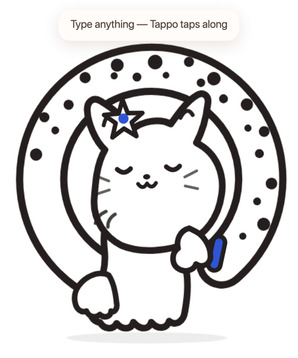

# Frank Tappo

跨平台的交互式桌宠：你在电脑上敲键盘、点鼠标，Tappo（一只墨线小猫）就会跟着拍爪。目标是让任何人都能把自己的形象放上桌面——不只是猫。



- 状态：**M0 技术验证**（2026-11）
- 目标平台：Windows 10/11、macOS 12+（Apple Silicon / Intel）
- 产品文档：[PRD.md](./PRD.md) · [M0 验证报告](./docs/M0-technical-verification.md) · [开发日志](./docs/dev-log.md)

## 技术栈

| 层 | 选型 |
| --- | --- |
| 外壳 | Tauri 2（Rust） |
| 前端 | TypeScript + Vite（无框架） |
| 全局输入 | 自建 CGEventTap（macOS）/ [rdev](https://crates.io/crates/rdev) `WH_KEYBOARD_LL`（Windows） |
| 动画 | 原生 SVG + CSS，状态机在 `src/main.ts` |

## 开发

```bash
npm install
npm run tauri dev   # 启动桌面应用（Windows；macOS 见下方说明）
npm run dev         # 仅启动前端，在浏览器里预览 Tappo 动画
npm run build       # 前端类型检查 + 打包
```

macOS 开发注意事项：

- 全局键盘监听需要**「输入监控」**权限（系统设置 → 隐私与安全性 → 输入监控），并且权限会记在**启动应用的父进程**名下。用 `npm run tauri dev` 从终端启动时，勾选 `frank-tappo` 也不会生效。
- 请改用 `./scripts/dev-macos.sh`：它会启动 Vite、编译后用 `launchctl submit` 让系统直接拉起二进制。日志在 `/tmp/frank-err.log`（延迟采样 `[latency]` 也在这里）。
- 授权后**必须重启一次应用**（`./scripts/dev-macos.sh`）——macOS 15 会在进程内缓存授权判定。
- 重新编译不再影响授权：脚本会用本机 Apple Development 证书对二进制签名，签名身份固定。
- 应用以 `Accessory` 模式运行（无 Dock 图标），通过菜单栏托盘图标操作：显示/隐藏、点击穿透、设置、退出。
- 语言默认跟随系统，可在托盘「设置…」中切换中文 / English，切换即时生效并持久化到应用配置目录。
- 设置页提供「大小」滑块（当前 50%–150%，默认 75%），拖动即时预览窗口尺寸，松手保存；角色始终锚定屏幕右下角。

## 目录结构

```
src/                      前端：角色 SVG、动画状态机、权限引导
src/i18n.ts               中英文案字典与本地化应用
src/settings.ts           设置页逻辑（语言切换）
settings.html             设置页入口
src-tauri/src/input.rs    全局输入监听（隐私过滤层）
src-tauri/src/permissions.rs  macOS 权限检测
src-tauri/src/settings.rs 语言设置持久化与系统语言解析
src-tauri/src/lib.rs      窗口、托盘、命令注册
scripts/dev-macos.sh      macOS 开发启动（launchctl + 稳定签名）
docs/                     M0 验证报告与开发日志
PRD.md                    产品需求文档
```

## 隐私约定（不可妥协）

- 只向界面传递「键盘左半区 / 右半区」和「鼠标按键」事件。
- 原始按键值、字符、输入内容不离开 Rust 监听线程，不落盘、不上传、不打印。
- 无账号、无远端服务即可使用。
