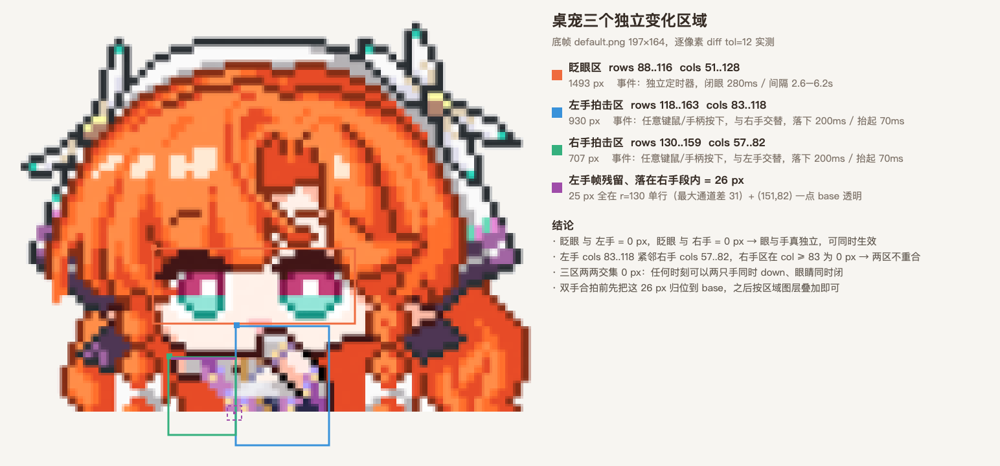

# 第二个大版本的细小更新（2026-11-20 → 2026-11-25）

基线：`dbc7528`（2026-11-19 21:42，0.1.0 首个完整试用版）。下面是这条基线之后的增量，按主题汇总；逐日的时间顺序仍看 [dev-log.md](./dev-log.md)。

- 本文件覆盖的改动已于 2026-11-27 随 `0.2.1` 一起提交（`023c1d4`）；本文件写作时的版本号是 `0.2.0`（`package.json:4`、`src-tauri/Cargo.toml:3`、`src-tauri/tauri.conf.json:4`，`package-lock.json` 同步），打包前统一升到了 `0.2.1`。
- 长按只计一次、Windows 原生拖动循环、0.1.0 打包与签名限制已在 dev-log 的 11-20 / 11-21 章节记录，这里不重复。

## 1. 角色状态帧：六张整帧 + 三个独立变化区域

- 定架构（他原话）：「这个桌宠应该有三个独立的变化区域，互不影响：眨眼变化区域，左手拍击变化区域，右手拍击变化区域……独立自主接受事件才是好架构。」
- 渲染形态 = `hand ∈ {up, left, right}` × `eyes ∈ {open, closed}` 的六张同画布整帧（197×164），`#stage` 上两个正交属性 `data-hand` / `data-eyes`，CSS 只做 `visibility` 切换（`src/styles.css:77-119`）。选整帧而不是眼睛覆盖层，是因为同画布让对齐在任何缩放下由构造保证，覆盖层才会被时序切出接缝。
- 逐像素 diff（tol=12）实测的三个变化范围：

  | 区域 | rows | cols | 变化像素 | 触发源 |
  | --- | --- | --- | --- | --- |
  | 眨眼 | 88..116 | 51..128 | 1493 | 独立定时器 |
  | 左手拍击 | 118..163 | 83..118 | 930 | `input:activity`，与右手交替 |
  | 右手拍击 | 130..159 | 57..82 | 707 | `input:activity`，与左手交替 |

  两个口径要分开说：**按声明框限制后**眨眼 ∩ 左手 = 眨眼 ∩ 右手 = 左手 ∩ 右手 = 0，三个框两两不相交（左手框按他指的箭头收紧到右手框右侧，cols 从 58 改为 83；右手区在 col ≥ 83 实测 0 px，所以两个框紧邻而不重合）。但 **按原始 diff 坐标集合**（manifest 草案第 2 节第 1 条的口径）`hand_left ∩ hand_right = 24 px`——就是下面那 26 px 里的 24 个。之前我在笔记和文档里写的"左手 ∩ 右手 = 0"只在前一个口径成立，现已按校验器实测更正。
  收紧后左手帧仍有 26 px 落在右手段内：25 px 全在 r=130 单行（最大通道差 31，属边缘混色），另 1 px 在 (151,82)（base 全透明、两只手都涂到）。这 26 px 归位到 base 之后，双手合拍可以直接按区域图层叠加。
- 设计图：（`docs/assets/state-regions.png`，底帧为 `src/assets/default.png` 的放大副本，紫色实心条即 r=130 那 25 px，紫色虚线小框即 (151,82)）。
- 六张素材已验收哈希：`default.png` `8c72e5ba…` / `left-hand.png` `d1fbc299…` / `right-hand.png` `6d9a7f1d…` / `default-eyes-closed.png` `dae286ac…` / `left-hand-eyes-closed.png` `13c5fe88…` / `right-hand-eyes-closed.png` `97bca7be…`。
- 右手帧用**局部补丁**生成（从 default 出发只贴框内像素，区域外 0 变化，两边都判成发丝的坐标保留 default 原像素），不是整帧替换；左手帧是质量标准本身，未动。

## 2. 拍击节奏

- 落下 200 ms / 抬起 70 ms（`src/main.ts:44-45`）；落下时长他连着要了两次"一点点"（150 → 200 ms）。
- 每次启动都左手先，完成一次拍击换到另一只手（`src/main.ts:50`、`src/main.ts:60-61`）。
- 快速输入不积压：动画进行中的新输入只登记一次"欠拍"，抬手后补一下（`src/main.ts:65-68`、`src/main.ts:93-94`）。
- 拍击时角色不抖动——没有身体位移，只有手臂帧切换。
- 冲击火花只做设计原图里有的三条圆头短线，位置随左右手切换（`src/styles.css:121-150`）。

## 3. 眨眼

- 独立时钟，不读手臂状态、也不被手臂读取（`src/main.ts:72-87`）。
- 闭眼时长 140 ms → **280 ms**（`src/main.ts:72`）：2026-11-25 为"更有活人感、不急促"连调四档，每档 +40 ms（180 / 200 / 240 / 280）。
- 间隔随机 2.6–6.2 s、启动后 2.6 s 眨第一次，这两个数未动。
- `document.hidden` 时跳过这一轮，并在 `visibilitychange` 的 hidden 分支强制回到 `eyes=open`（`src/main.ts:146-152`）——后台定时器被节流时，被打断的眨眼否则会卡成闭眼，这条兜底与 `raiseArm()` 对称。

## 4. 计数板与控制栏

- 底色 `#fff0da` → `#f7f2e8`（`src/styles.css:167`）。
- 板宽 336 + 左外移 16，使齿轮图标墨迹右缘落在美术画布 x=346，与角色右缘对齐（`src/styles.css:157-160`）。
- 计数用 `BigInt`，字号按位数自适应 `min(32, 400 / 位数)`（`src/main.ts:28-35`）。

## 5. 应用图标与托盘图标

- 源图 `app-icon.png`（300×300，`a2a7bdfc…`）保持直角原样，圆角只在生成阶段加。
- 参数由本机 19 个真实 macOS 应用图标的轮廓实测得出：不透明内容占画布中位 **0.805**（即 Apple 的 824/1024 网格），角是**圆弧**（对 Qoder 图标逐行拟合圆模型，误差 <0.005，超椭圆拟合不上），半径/内容宽中位 **0.239**。
- 出图：`--content 0.805 --radius 0.26 --exponent 2`，渲染后实测角半径 0.239，正中样本中位。
- 已更新 `icon.icns`、`icon.png`、`128x128.png`、`128x128@2x.png`、`64x64.png`、`32x32.png`；托盘 `tray-original.png` 64×64 **只圆角、不留边**（菜单栏要占满行高）。
- `icon.ico` 与 `Square*Logo.png`、`StoreLogo.png` 保持直角满幅：Windows 自己裁圆角，预裁会双重变形。
- 托盘图已生效（新 png 字节确认嵌在运行中的二进制里）；Dock 图标要等重打包替换 `/Applications/Frank Tappo.app` 才会换。

## 6. 拖动：点击不再移动桌宠

- 现象：点击角色眼睛周围或最右侧，桌宠整体向左平移，多点几次累积位移（实测 983 → 936）。
- 根因两条，都修了：
  1. `start_pet_drag` 在非 Windows 分支把 `CanvasGeometry.offset`（`enclosing_frame` 的亚像素取整）也加进了抓取点，而 WKWebView 是钉在 **NSWindow frame 原点**的，导致每次绝对定位都落在光标左上方约 1 pt 并累积。改为只用 `client × scale`（`src-tauri/src/lib.rs:403-416`）。
  2. 前端没有点击/拖动阈值，静止的一次点击照样发 `end_pet_drag(cursor)` 写一次位置。新增 3 屏幕像素阈值，超过才启动拖动（`src/main.ts:273`、`src/main.ts:341-347`）。
- 新增几何测试 `macos_drag_maps_client_points_to_the_frame_origin`（`src-tauri/src/lib.rs:1195`），覆盖 2 种 DPI × 3 种缩放 × 3 组抓取点，断言"原地按下松开必须还原窗口位置"。它替换了原先专门锁定"保留 canvas offset 换算"的旧测试——那条与实测坐标系矛盾，是否回滚仍待他表态。
- 2026-11-25 他确认「点击移动的bug好像修好了」；临时探针（`__PROBE__` 埋点 + 本地 8765 采集进程）已从 `src/main.ts` 删除。

## 7. 输入监听与开发链路

- 重编一律走 `scripts/dev-macos.sh`：Vite 单独跑，二进制由 `launchctl submit` 拉起并用固定的 Apple Development 身份重签，`input_monitoring=true` 跨重编保持（本轮多次实测）。
- 已知缺陷：脚本里 `launchctl remove` 紧接 `submit` 时，submit 返回 0 但任务没落地，脚本照样打印 "started"（2026-11-25 14:40 复现，`/tmp/frank-err.log` mtime 停在 14:28，`launchctl list` 查不到）。单独重投一次即恢复。**是否给脚本加 submit 后校验，待他拍板。**

## 8. 0.2.0 release 包（2026-11-25 15:25）

- 58 项 Rust 测试通过后 `npx tauri build`，产物 `src-tauri/target/release/bundle/dmg/Frank Tappo_0.2.0_aarch64.dmg`（4,372,609 字节，SHA-256 `6487fa535289f01e8dca490a94a36969c63503e708313673b2bcc1d8b965d523`，`hdiutil verify` 通过）与 `bundle/macos/Frank Tappo.app`（5.52 MiB）。
- `lipo -archs` = arm64 单架构；`codesign --verify --deep --strict` 通过、`satisfies its Designated Requirement`，TeamIdentifier `GML6M83HDT`、hardened runtime。包内六张素材 md5 与第 1 节的验收哈希逐一对上，`icon.icns` 是新的圆角版。
- 签名仍是 Apple Development、未做公证：给解包副本加上 `com.apple.quarantine` 后 `spctl -a -t exec` 返回 `rejected`（普通与右键打开两种上下文都是），所以别的 Mac 上要靠 `xattr -dr com.apple.quarantine` 去隔离属性才能启动。打包版在同学机器上的首次打开、输入监控授权和 Intel Mac 兼容性未经真机验证；Windows 仍需在那台电脑上自己构建。
- 没有替换 `/Applications/Frank Tappo.app`，也没有启动打包实例；开发实例仍是 14:40 那个二进制（mtime 未变），输入监控授权不受影响。

## 9. 皮肤包 manifest 与校验器（2026-11-25）

- 草案：[docs/skin-manifest.md](./skin-manifest.md)。像素风是硬约束（他定），批量出角色但眨眼/拍手原理不变，靠"三个区域 + 全画布整帧 + 不许声明时间参数"这三条不变量兜住。
- 实例：`src/assets/manifest.json`（当前角色 xigerika）。三区域的 rows/cols/changed_px 由校验器实测回填，六帧的 `sha256` + `md5` 都写在里面；`src/assets/lock.json` 是它生成的产物。运行时还没读它（`index.html` 六个 `` 仍是硬编码），第 8 节那五条接入项等他拍板才动。
- 校验器：`src-tauri/tests/skin_manifest.rs`，`cargo test --test skin_manifest`。`png 0.18.1` / `sha2 0.10.9` 只加进 `[dev-dependencies]` 并用 `=` 锁死已在 `Cargo.lock` 里的版本——不联网取新包、不进发布二进制、`cargo test` 仍是唯一的门（58 项原有测试无回归）。
- 判定口径与 `/tmp/tappo-pipeline` 的 Swift 脚本一致（alpha 阈值 128、tol=12、两侧全透明的像素不计入），两套独立实现给出同一批数字：eyes 1493 / hand_left 930 / hand_right 707、左手帧原始 diff 956 px、左手 ∩ 右手原始集合 24 px。
- 当前包 **54 条 fail**，全部有坐标与颜色：license 的 TODO 1 条、区域交集 1 条、`left-hand.png` 与 `left-hand-eyes-closed.png` 各 26 条（r=130 cols 58..82 的边缘混色 25 px + (151,82) 那 1 个 base 全透明却被涂色的像素）。其余四帧"区域外 0 变化"通过。这个红门是有意的：它报的就是今天量出来的那 26 px，不是校验器写坏了。
- 两条合成素材测试锁住判定本身：越界改动必须按 `文件 + r/c + 两侧颜色` 报出、眨眼与手臂改到同一像素必须被交集条拦住，合法改动不误报。
- `core_plus_antialias` 与 `derived` 的重算分支没有实现，声明了就直接 fail 并说明原因——色表阈值和派生参数还没拍板，我不猜一套判定然后让它假装通过。

## 10. 未验收与待拍板

- 双手合拍：三个区域框已两两不相交，剩下的是左手帧里那 26 px（r=130 单行 25 px + (151,82) 1 px），它同时也是校验器第 4 条报出的那 24 px 交集。把这 26 px 归位到 base，第 9 节那 52 条 fail 和第 1 节说的交集 fail 一起消掉，双手合拍即可按区域图层叠加、不需要专用帧；**是否现在动左手帧，待他拍板。**
- manifest 第 9 节三条待拍板：色表模式、画布尺寸是否统一 197×164、`source` 与 `derived` 是否共存。
- 区域约束的仓库内校验脚本：他 2026-11-25 说了"继续写校验器"，已落地（第 9 节）。当前包报 54 条 fail，其中 52 条是素材本身的问题（那 26 px），不是校验器误报。
- 本轮改动已于 2026-11-27 全部提交（`023c1d4`，版本 `0.2.1`）；「更多」窗口等 11-25 之后的增量见 dev-log 的 2026-11-27 章节。
- 打包替换 `/Applications/Frank Tappo.app` 需他明确授权，之后 Dock 图标才是新的。
- Windows 侧仍需实机验收；空闲 CPU 优化（release ≈ 4.2%）在待办里。
